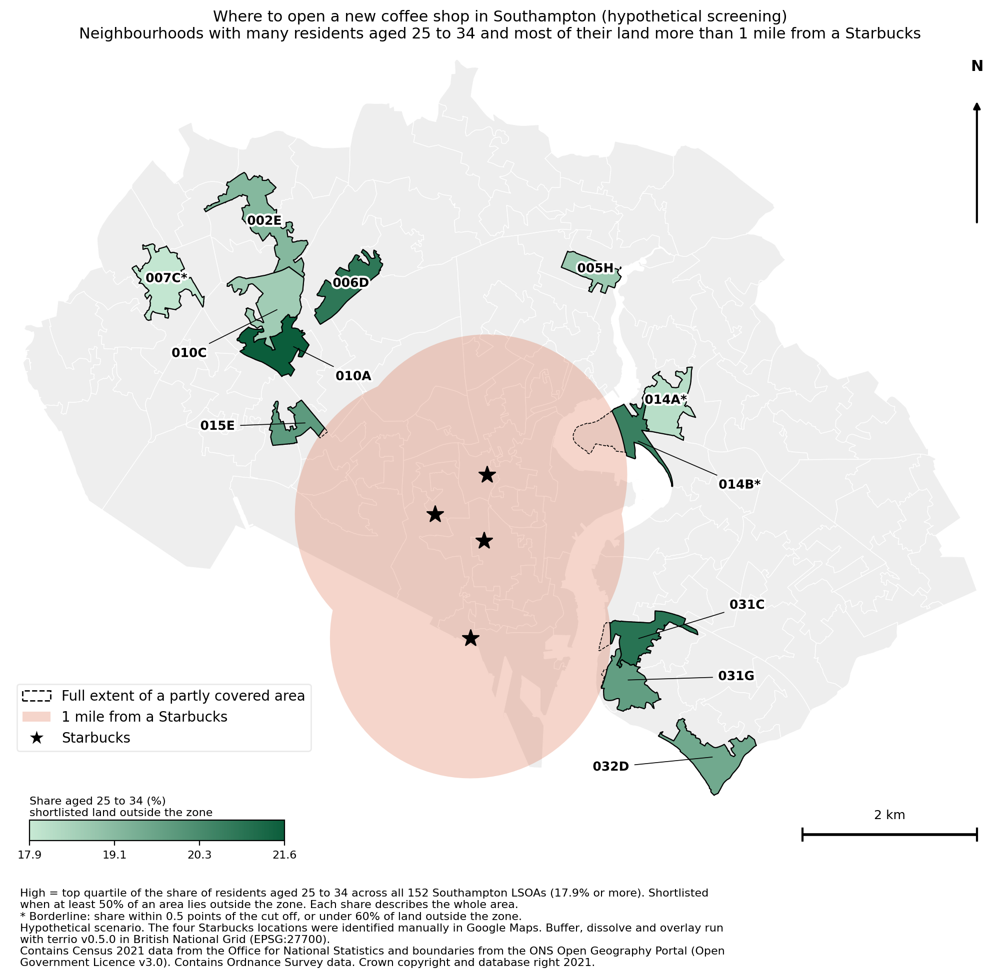

# Where to open a new coffee shop in Southampton

A hypothetical site screening built with terrio v0.5.0, a pure Rust geospatial command line tool.



## Question

Which Southampton neighbourhoods have many residents aged 25 to 34 and most of their land more than one mile from every Starbucks? The full scenario and definitions are in [docs/problem_statement.md](docs/problem_statement.md).

## Result

Twelve of the 152 Southampton neighbourhoods qualify. Eight lie entirely outside the one mile zone. Four are partly inside it but keep at least 90% of their land outside.

| Rank | LSOA | Share aged 25 to 34 (%) | Land outside zone (%) | Borderline |
|---|---|---|---|---|
| 1 | 010A | 21.6 | 100.0 | No |
| 2 | 031C | 21.0 | 90.2 | No |
| 3 | 006D | 20.9 | 100.0 | No |
| 4 | 014B | 20.7 | 50.7 | Yes, under 60% of land outside |
| 5 | 015E | 20.0 | 97.2 | No |
| 6 | 031G | 19.9 | 98.4 | No |
| 7 | 032D | 19.6 | 100.0 | No |
| 8 | 002E | 19.2 | 100.0 | No |
| 9 | 005H | 18.8 | 100.0 | No |
| 10 | 010C | 18.6 | 100.0 | No |
| 11 | 014A | 18.2 | 100.0 | Yes, share close to the cut off |
| 12 | 007C | 18.0 | 100.0 | Yes, share close to the cut off |

Findings:

- Neighbourhood 010A has the highest share (21.6%) and sits fully outside the zone.
- The four Starbucks cover 10.23 km² of the city's 49.88 km². The zone covers a large part of the city centre and the docks.
- Requiring a neighbourhood to be wholly clear of the zone gives 8 areas. Allowing partial overlap with at least 50% of land outside adds 4 more (031C, 014B, 015E and 031G).
- Three candidates are borderline and should be treated with caution.

## Interactive dashboard

`outputs/southampton_coffee_dashboard.html` is a standalone page. Double click it to open it in a browser. It needs an internet connection for the map tiles. It offers OpenStreetMap, Esri streets and Esri satellite basemaps, a ranked list, a minimum share filter and an opacity slider.

OpenStreetMap tiles usually refuse pages opened as local files, so the page starts on Esri streets in that case.

## How terrio was used

```
terrio buffer --distance 1609.34 data/processed/starbucks_bng.gpkg data/processed/starbucks_buf.gpkg
terrio dissolve data/processed/starbucks_buf.gpkg data/processed/exclusion.gpkg
terrio overlay --operation intersection data/processed/lsoa_share.gpkg data/processed/exclusion.gpkg data/processed/covered.gpkg
terrio overlay --operation difference data/processed/lsoa_share.gpkg data/processed/exclusion.gpkg data/processed/outside.gpkg
```

Terrio prefixes the columns of an overlay output with `a_` (first input) and `b_` (second input). Distances are in the units of the coordinate system, so the data is reprojected to British National Grid (metres) first.

## Method

1. Join the Census 2021 age table to the LSOA boundaries and calculate the share aged 25 to 34.
2. Buffer each Starbucks by one mile and dissolve the circles into one exclusion zone.
3. Cut the zone out of each LSOA to measure the land that remains.
4. Keep LSOAs in the top quartile of the share with at least 50% of their land outside the zone.
5. Rank by share and flag borderline cases.
6. Produce the table, the static map and the dashboard.

## Reproduce

Requirements: Python 3.10 or later, terrio v0.5.0 on the PATH and the packages in `requirements.txt`.

```
pip install -r requirements.txt
python scripts/run_all.py
```

The raw inputs must be in `data/raw/` (see the table below).

## Folder structure

```
data/raw/          inputs
data/processed/    terrio outputs
scripts/           pipeline
outputs/tables/    result tables
outputs/           dashboard and its data
MAPS/              main map
MAPS/sensitivity/  alternative scenario maps
docs/              problem statement
```

## Data and attribution

| Data | Source | Licence |
|---|---|---|
| Age by five year bands, TS007A, 2021 | Office for National Statistics, via Nomis | Open Government Licence v3.0 |
| LSOA December 2021 boundaries | ONS Open Geography Portal | Open Government Licence v3.0 |
| Starbucks locations | Identified manually in Google Maps | Coordinates only |
| Dashboard basemaps | OpenStreetMap contributors; Esri, HERE, Garmin, Maxar and Earthstar Geographics | Per provider terms |

Contains Census 2021 data from the Office for National Statistics. Contains Ordnance Survey data. Crown copyright and database right 2021.

## Limitations

- The Census age bands end at 34, so the share covers 25 to 34 and not 25 to 35.
- The share describes a whole neighbourhood. Residents may not be spread evenly across the land outside the zone.
- Only four Starbucks were used, found manually. Other coffee shops and competitors are ignored.
- Distance is a straight line, not a walking time.
- Residents are a proxy for demand. Footfall, rents and planning constraints are not considered.
- The dashboard geometries are simplified by 3 m for file size.
- The scenario is hypothetical and not business advice.

## Status

Southampton analysis complete. A possible extension is to scale the method to England.
